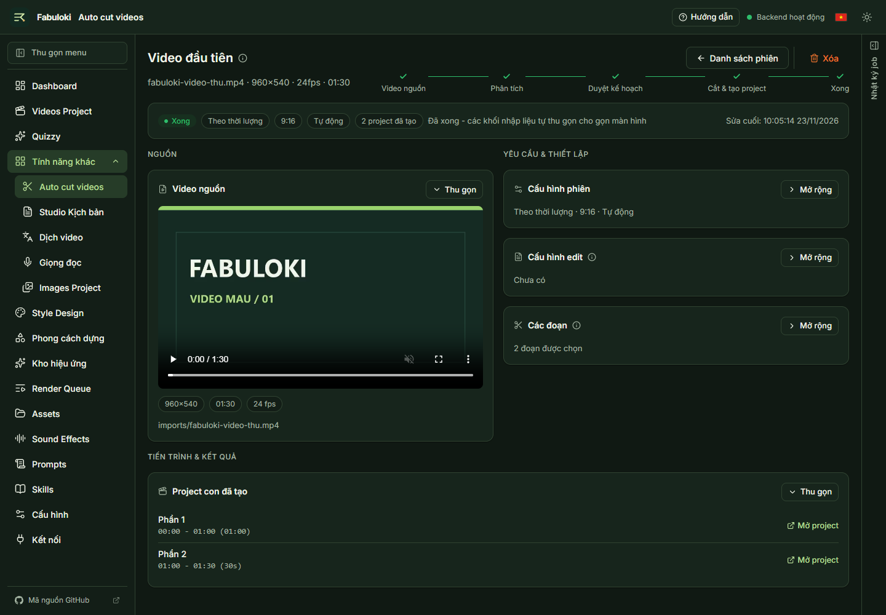

# Fabuloki

Fabuloki là app dựng video tại máy cho nội dung kể chuyện bằng tiếng Việt. Bạn có thể đưa clip vào để cắt hoặc dịch, bắt đầu từ bài viết để làm video có giọng đọc, rồi chỉnh cảnh, phụ đề và âm thanh trên timeline trước khi xuất MP4.

**[Cài và mở](#cài-và-mở-fabuloki) · [Chọn công cụ](#bạn-muốn-làm-gì) · [Làm video đầu tiên](#video-đầu-tiên)**



*Fabuloki trên Windows sau khi chia một clip mẫu 90 giây thành hai project video dọc.*

## Cài và mở Fabuloki

Fabuloki chạy trên máy bạn và mở tại [127.0.0.1:6868](http://127.0.0.1:6868). Cần kết nối mạng ở lần cài đầu. Nếu chưa cài Git, hãy cài [Git](https://git-scm.com/downloads) hoặc chọn **Code → Download ZIP** trên GitHub và giải nén toàn bộ thư mục.

### Windows

Trong PowerShell, sao chép và chạy:

```powershell
git clone https://github.com/cogailatte/fabuloki.git
cd fabuloki
& ".\Open Fabuloki.cmd"
```

Nếu đã có thư mục repo, mở thư mục đó trong File Explorer và bấm đúp [Open Fabuloki.cmd](Open%20Fabuloki.cmd). Launcher dùng [WinGet](https://learn.microsoft.com/windows/package-manager/winget/) để cài những mục còn thiếu trong Node.js, FFmpeg và Chrome, rồi dựng và mở app. Nếu Terminal báo thiếu WinGet, cài **App Installer** từ Microsoft Store.

### macOS

Trong Terminal, sao chép và chạy:

```bash
git clone https://github.com/cogailatte/fabuloki.git
cd fabuloki
bash "./Open Fabuloki.command"
```

Nếu đã clone repo, mở thư mục đó trong Finder và bấm đúp [Open Fabuloki.command](Open%20Fabuloki.command). Nếu giải nén từ ZIP, bạn cũng có thể dùng dòng lệnh `bash` ở trên trong thư mục vừa giải nén. Launcher dùng [Homebrew](https://brew.sh/) để cài các mục còn thiếu. Lần đầu Terminal có thể hỏi xác nhận cài Homebrew hoặc công cụ của Apple.

### Mở lại và cập nhật

- Mở lại bằng cùng tệp. Nếu app đang chạy, launcher mở lại trang trong trình duyệt.
- Muốn cập nhật bản clone, chạy `git pull` trong thư mục Fabuloki rồi mở lại. Giữ cửa sổ lệnh mở khi sử dụng và nhấn Ctrl+C để dừng.
- Vào **Kết nối** để thiết lập tài khoản AI theo nhu cầu. faster-whisper, VieNeu-TTS và model ngoại tuyến cài riêng khi cần.

## Bạn muốn làm gì?

| Việc cần làm | Mở trong Fabuloki |
| --- | --- |
| Dựng một clip sẵn có, chỉnh cảnh, phụ đề, nhạc và hiệu ứng | **Videos Project**. Xem lại bản nháp trên timeline trước khi xuất bản cuối. |
| Chia video dài thành nhiều clip ngắn | **Tính năng khác → Auto cut videos**. Chọn cắt theo thời lượng, theo nội dung AI đề xuất hoặc theo yêu cầu của bạn. |
| Biến văn bản hoặc bài viết thành video có lời kể | **Tính năng khác → Studio Kịch bản**. Duyệt kịch bản và giọng đọc trước bước dựng. |
| Thêm phụ đề dịch hoặc lồng tiếng cho clip | **Tính năng khác → Dịch video**. Bóc lời thoại, duyệt bản dịch, rồi chọn phụ đề, lồng tiếng hoặc cả hai. |
| Thử giọng đọc tiếng Việt trên máy | **Tính năng khác → Giọng đọc**. Cài VieNeu-TTS rồi nghe thử một giọng có sẵn. |
| Chuẩn bị nhận diện chung cho một series | **Style Design** để quản lý màu, font và logo. Dùng **Phong cách dựng** để chọn cách thể hiện cho từng video. |

Mở **Hướng dẫn** ở thanh trên cùng để đọc hướng dẫn của trang đang xem. Các tính năng dùng AI trực tuyến cần thiết lập dịch vụ tương ứng trong **Kết nối**. Bài thử bên dưới chỉ dùng chế độ cắt theo thời lượng.

## Video đầu tiên

Thử biến một clip khoảng **90 giây** thành **hai clip dọc 9:16**, dùng video bạn có quyền sử dụng.

1. Mở **Tính năng khác → Auto cut videos → Tạo phiên cắt**. Bấm **Tải video lên** và chọn clip từ máy.
2. Chọn **Theo thời lượng**, đặt **Số phút mỗi đoạn** là `1` và chọn tỉ lệ **9:16**. Tắt **Tạo lời thoại (transcript)** và **Chạy AI edit luôn sau khi cắt**. Bấm **Tạo phiên cắt & phân tích**.
3. Trong **Các đoạn**, xem mốc cắt và giữ hai đoạn được chọn. Bấm **Cắt & tạo project**.
4. Khi trạng thái chuyển sang **Xong**, bấm **Mở project** ở **Project con đã tạo** để xem từng clip. Các file MP4 đã cắt nằm trong thư mục `assets/` của từng project con dưới `video-projects/`.

Từ project con, bạn có thể tiếp tục chỉnh trên timeline hoặc mở **Hướng dẫn** để xem các bước dựng, kiểm tra và xuất bản cuối.

## Phát triển

Chạy `npm run check:environment` để kiểm tra môi trường, `npm run dev` để phát triển và `npm run typecheck` để kiểm tra kiểu. Cấu hình cục bộ trong `.env` dựa trên [mẫu biến môi trường](.env.example). Có thể đặt biến môi trường `NEXT_PUBLIC_FABULOKI_REPO_URL` thành URL repo công khai trước khi build để hiện liên kết mã nguồn trong app.

## Bản đồ mã nguồn

| Khu vực | Vai trò |
| --- | --- |
| [apps/web](apps/web) | Dashboard, timeline, thư viện, Studio Kịch bản, Quizzy và các giao diện tác vụ. |
| [apps/server](apps/server) | Dự án, kết nối AI, SQLite, QC và hàng đợi dựng. |
| [engines/remotion](engines/remotion) | Lắp timeline và xuất video hoặc ảnh. |
| [.claude/skills](.claude/skills) | Chỉ dẫn mà phiên dựng chọn theo dự án. |
| [assets](assets) | Danh mục dùng chung, phong cách, font và hiệu ứng. |
| [docs/SPEC.md](docs/SPEC.md) | Hành vi hiện hành và phép thử. |
| [docs/SOURCE-MIGRATION.md](docs/SOURCE-MIGRATION.md) | Danh sách tệp đã chuyển và những gì bỏ lại. |

Quy trình dự án nằm trong [AGENTS.md](AGENTS.md).

## Giấy phép và ghi công

Fabuloki phát triển từ **Bisedit**, một bản chỉnh sửa AIEVv2. Dự án gốc là [AIEVv2 của noti.vn](https://github.com/notivn/AIEVv2). Thông báo `Copyright (c) 2026 noti.vn` và nội dung giấy phép MIT được giữ trong [LICENSE](LICENSE).

Logo, font, âm thanh và thư viện phụ thuộc có điều khoản riêng. Xem [Nguồn và giấy phép](THIRD_PARTY_NOTICES.md) để biết chi tiết.
